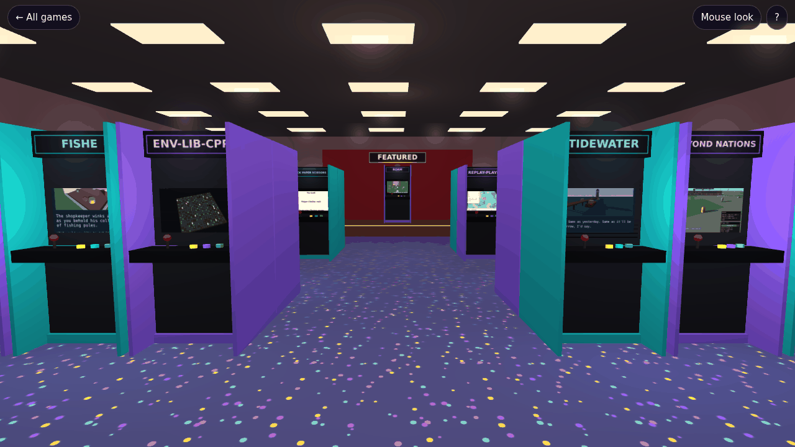
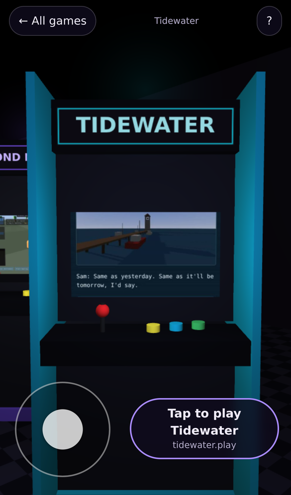
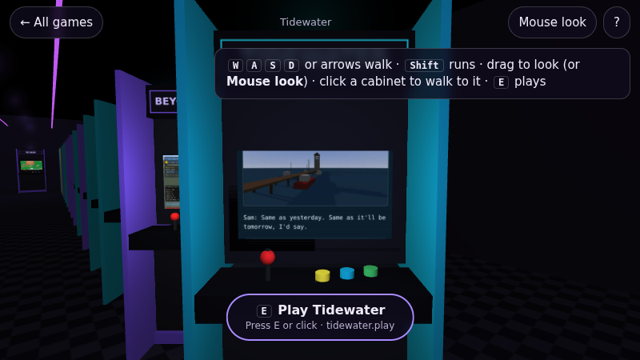
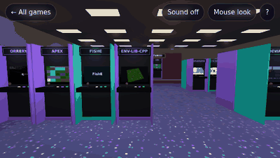

# arcade

[![A bright 3D arcade floor seen from a corner by the door: islands of back-to-back cabinets on a patterned arcade carpet (neon squiggles, rings and triangles) under framed light panels in a tiled ceiling, one cabinet per game on play.danielstephenson.dev, with red stools tucked under some of them and a change and prize counter by the entrance. Each screen shows that game's own picture and each marquee its title; each cabinet has a sloped control deck, a coin door with glowing coin slots, a speaker grille, side art made from its poster and a T-molding edge in violet, teal or orange by GitHub organisation. Roam stands alone on a raised stage at the back wall under a FEATURED sign. Rendered with Strata 0.7.0.](docs/media/arcade-hall.png)](docs/media/arcade-hall.gif)

*Every game arcade serves, as a cabinet in one hall: the screen is the game's own poster image (Familiar, with no poster yet, gets a title card) and the marquee its title, the islands nearest the door have the most plays, and Roam has the stage at the back. Drawn with [Strata](https://github.com/Preponderous-Software/strata) 0.7.0 by [`tools/make_hall_media.py`](tools/make_hall_media.py) from the public registry; click for a walk from the door towards the stage. [`arcade-hall.sources.json`](docs/media/arcade-hall.sources.json) lists which image is on which screen.*

**[Walk the hall](https://play.danielstephenson.dev/hall/)**: the same hall in the browser, in real time. Walk
up to a cabinet and play its game (see [The hall](#the-hall)).

One static host for every browser game. arcade serves each game's page, bundle and kit assets at
`<slug>.play.danielstephenson.dev`, with the cross-origin isolation headers the
[tak](https://github.com/Stephenson-Software/tak) kit needs. A game deploys by uploading a versioned
bundle from its own CI, and rollback is a repoint, not a rebuild.

arcade is designed in **RFC 0006, "A Static Hosting Service for Browser Games"** (Stephenson-Software
RFCs; Accepted, v1.1). The portal that lists the games is <https://danielstephenson.dev/play>.

arcade serves files and runs nothing. Every game runs in the player's own tab, with its saves in
that browser's IndexedDB. The service is standard-library Python with one data volume and no
database.

## How it answers

| Host | What it serves |
|---|---|
| `play.<base>` | the upload API (below); `/` is a landing page listing every game and `/hall/` the walkable hall (see below) |
| `<slug>.play.<base>` | the game registered under that slug |
| an alias from the registry | the same game, at an older hostname, so that origin's saves are kept |
| anything else | 404 |

Game routes mirror `tak.web.serve` route for route, so a page built for a per-game container works
unchanged:

| Path | Response |
|---|---|
| `/`, `/play`, `/play/`, `/index.html` | the current version's `index.html` |
| `/web/game.zip`, `/web/version.txt` | the current version's files |
| `/tak/<asset>` | that asset from **the game's own** `game.zip` (`src/tak/web/assets/`), so the kit's Python and JavaScript halves always match (RFC 0006 §5) |
| anything else | 404 |

A game's host is read-only: a `PUT` or `POST` to it gets 405. A game with nothing deployed answers
404.

Every response, errors included, carries `Cross-Origin-Opener-Policy: same-origin`,
`Cross-Origin-Embedder-Policy: require-corp` and `Cross-Origin-Resource-Policy: cross-origin`
(cross-origin so that the portal can embed a game in an iframe). The exceptions are a `static`
game with isolation off (see [Bundle kinds](#bundle-kinds-rfc-0012)) and the hall's page at plain
`/hall/` (see [The hall](#the-hall)), which get none of the three.
Files are sent with an `ETag` and `Cache-Control: no-cache`, so a returning player revalidates
instead of downloading again. For a game with a `canonical:` URL, every HTML response also carries
`Link: <url>; rel="canonical"`. `/healthz` answers `ok` on any host.

### Compression

Files are sent in 64 KiB chunks, never read whole, so a large `.data` or `.wasm` costs arcade no
more memory than a small one. Compressible files (`application/wasm`, HTML, JavaScript, CSS, plain
text, JSON, web manifests and SVG, 1 KiB or more) get a gzip copy, `<name>.gz` at level 9, written
once when the version is uploaded. A version stored before this gets its copies lazily: the first
request for a file is answered uncompressed and queues its `.gz`, which one background thread
writes, one file at a time, atomically. A bundle that ships its own `<name>.br` or `<name>.gz` (as
dotnet and Emscripten builds can) has those used as they are; brotli is not in the standard library,
so arcade serves `.br` only when the bundle brings one.

The variant is chosen by `Accept-Encoding` (q-values honoured; `br` before `gzip` when both are
equally acceptable) and sent with `Content-Encoding`, `Vary: Accept-Encoding` and its own `ETag`
(`"<version>-<file>-gz"` or `-br`; the uncompressed file keeps its old tag). `Content-Type` is that
of the original file, so a `.wasm` is still `application/wasm` and compiles while it streams. A
response that already carries `Content-Encoding` is passed through untouched by a compressing proxy
such as Traefik's `compress` middleware. `Range` requests are not supported; the whole file is sent.

## The registry

`games.yaml` lives in the gateway repository and is mounted read-only at `/config/games.yaml`.
Reserving a slug is a gateway pull request that adds one entry:

```yaml
games:
  - slug: tidewater                      # ^[a-z][a-z0-9-]{1,30}$
    title: Tidewater
    repo: Stephenson-Software/Tidewater
    owner: dmccoystephenson              # optional
    token_sha256: "<64 hex>"             # sha256 of the game's upload token
    aliases: [tidewater.danielstephenson.dev]   # optional
    kind: tak                            # optional: tak (default) or static
    isolation: on                        # optional: on/off (see Bundle kinds)
    canonical: https://danielstephenson.dev/play/tidewater   # optional
    added: 2026-10-01                    # optional: the day it joined the arcade
    tags: [story, puzzle]                # optional: theme tags, for the filters
    engine: tak                          # optional: strata, tak, sdl or other
```

`tags` are short lowercase theme tags (`halloween`, `story`, `puzzle`, `sim`, ...): at most 6, each
matching `^[a-z][a-z0-9-]{1,23}$`, none twice, as a `[flow, list]`. `engine` is what the build runs
on: `strata` (Strata's WebGL 2 backend), `tak` (tak's console runtime), `sdl` (SDL through
Emscripten) or `other`. A static bundle does not say which engine built it (a Strata build and an SDL
build are both an Emscripten `index.html`), so it is stated here; a `tak` game is always `tak` and may
not say otherwise, and a `static` game without `engine` is `other`. The organisation a game is
filtered by is the part of `repo` before the slash. See [Filters](#filters).

`canonical` is the game's main public page, as an https URL. A game can be reached at its slug
host, its aliases and the portal page that frames it; when `canonical` is set, every HTML response
for the game names this one address with a `Link: <url>; rel="canonical"` header, so search engines
index it once. Leave it out and no Link header is sent.

`added` is the day (`YYYY-MM-DD`) the game joined the arcade. `/api/games` reports it as `added`
(ISO 8601 UTC, `"2026-10-01T00:00:00Z"`, or `null` when unknown), and the hall puts a NEW ribbon on
the marquee of a game added in the last 14 days. Without it, arcade uses the game's first upload,
which it records in `<data>/<slug>/.added` from now on; a game uploaded before that record existed
uses its oldest stored version while none has been pruned, and is otherwise unknown (never NEW) until
`added:` is given.

The parser is deliberately strict: it accepts only this subset of YAML, and it refuses unknown keys,
duplicate slugs, reserved slugs (`play`, `www`, `api`, `arcade`, `admin`, `static`), malformed
hashes, aliases under the arcade's own domain or claimed twice, an unknown `kind`, an `isolation`
other than on/off (or off for a tak game), a `canonical` that is not an https URL, an `added` that is not a real day,
a malformed or repeated tag, more than 6 tags, and an unknown `engine` (or one other than `tak` for a tak game), each with its
line number. arcade picks up changes to the file without a restart. A file that stops parsing is
logged and ignored, and the last good registry stays in force.

```sh
python -m arcade check-registry games.yaml
```

### A token for a new game

```sh
python3 -c "import secrets; print(secrets.token_urlsafe(32))" > token.txt
python -m arcade hash-token < token.txt     # → token_sha256 for games.yaml
gh secret set ARCADE_TOKEN -R <owner>/<game> < token.txt
rm token.txt
```

Only the hash is committed. Rotating a token is a registry PR plus a secret update.

### Bundle kinds (RFC 0012)

| `kind` | Upload | Served | `isolation` |
|---|---|---|---|
| `tak` (default) | exactly `index.html`, `game.zip`, `version.txt` | tak's routes; `/tak/` from the game's own `game.zip` | always on; cannot be turned off |
| `static` | any tree with `index.html` and `version.txt` at its root (a pygbag, Emscripten or plain HTML/JS build) | as files; `/` and `…/` serve `index.html`; `.wasm` is `application/wasm` | **off** by default, `on` to opt in |

The `static` kind defaults to no Cross-Origin headers because builds that fetch their runtime from a
CDN without `Cross-Origin-Resource-Policy` (pygbag loads from `pygame-web.github.io`) cannot run
under `require-corp`. Set `isolation: on` for a build that needs `SharedArrayBuffer`, such as
Emscripten with pthreads. A static upload refuses links, absolute paths, `..` and empty segments,
a top-level `.uploaded` (arcade's own upload-time marker) and a path that is both a file and a
directory, caps the file count at 10,000, and is subject to the same byte cap as a tak upload.

## The landing page

`https://play.<base>/` (and `/index.html`) is a small HTML page generated from the registry on each
request: every game by title, linked to `https://<slug>.play.<base>/` (a game with nothing deployed is
listed as "Coming soon", unlinked), and a prominent "Browse all games" link to `ARCADE_LANDING_URL`.
It has no script and makes no external request (its `Content-Security-Policy` is
`default-src 'none'; style-src 'unsafe-inline'; …`), follows the visitor's light/dark setting, is laid
out for a phone first, and is sent with `Cache-Control: public, max-age=60`. Set
`ARCADE_LANDING_MODE=redirect` to answer `/` with the old 302 to `ARCADE_LANDING_URL` instead.

### Filters

The landing page has chips for each theme tag, organisation and engine, and an order (A–Z, most
played, newest). They are plain links that put the choice in the query string, so the server renders
the filtered list (no script) and any combination is a link to share:

    /?tag=halloween
    /?org=Preponderous-Software&engine=strata&sort=plays

One value per facet; a game shows when it matches every facet given (case does not matter), and an
unknown value matches nothing. The chip in force is marked `aria-current="true"` and links back to the
list without it. The same query works on `/api/games` (`?tag=halloween` lists only those games) and
on the hall (`/hall/?tag=halloween`, below); `src/arcade/filters.py` is the one place that decides
what matches.

`/halloween` is the page for the `halloween` tag: the same list as `/?tag=halloween`, under its own
heading and in the colours of the hall's Halloween season (`seasons.py`, `Season.page`), with a link
into the hall with only the Halloween cabinets lit.

## The hall



 



`https://play.<base>/hall/` is the README picture made walkable, drawn live by
[Strata](https://github.com/Preponderous-Software/strata)'s web kit. It is opt-in: the landing page and
the portal keep their lists, and link here with "Walk the hall".

- **The layout is shared with the picture.** `src/arcade/hall.py` lays out the floor like a real arcade: a
  roughly square room with islands of back-to-back cabinets either side of a centre walkway (walkways are
  at least 2.5 m), a change and prize counter by the door, and Roam alone on a raised, lit stage at the
  back wall, in sight from the door. It orders the cabinets (the most played in the island nearest the
  door, nearest the centre first), places them, lists the room's props, signs and warm lights, colours their side panels by GitHub
  organisation and describes a cabinet's parts. `tools/make_hall_media.py` draws the README picture from it,
  and `GET /hall/layout.json` hands the same data, built from the live registry and play counts, to the page.
- **Walking.** WASD or the arrow keys (Shift runs), drag to look, or *Mouse look* (pointer lock; Esc
  stops). Click or tap a cabinet, or the floor, to walk there. On a phone: a stick under the left thumb, drag
  anywhere else to look, tap to walk. Cabinets, the stage, the counter and the walls are solid; a place
  saved under an older layout that is now inside something moves to the nearest walkway.
- **Playing.** At a cabinet the hall shows its title and "Press E / tap to play". With
  `ARCADE_HALL_EMBED=on` the game opens in a full-screen frame over the hall, with *Back to the hall*,
  which returns to the same spot. A game that needs cross-origin isolation (tak games, Roam) can only be
  framed by an isolated page, and a game without COOP/COEP cannot be framed by one, so the hall serves
  itself in either mode (`/hall/?isolated=1` sends COOP/COEP; plain `/hall/` does not) and, when a game
  needs the other mode, reloads itself in it with the game open. With `ARCADE_HALL_EMBED=off` (the
  default) a game opens as its own page and the browser's Back button returns to the hall. Either way the
  visitor's place is kept in the URL hash (`#p=x,z,yaw,pitch`) and in `sessionStorage`, and
  `/hall/?at=<slug>` starts in front of a cabinet. Turning framing on needs each game's
  `frame-ancestors` (the gateway's `game-headers`) to name `https://play.<base>` as well as the portal.
- **Cabinets.** `src/arcade/hall_model.py` builds one cabinet model, shared by the page and the
  picture: side panels with the classic profile and bevelled edges, edged with a T-molding strip in the
  organisation's colour; a sloped control deck with a joystick and buttons; a coin door whose two coin
  slots glow; a bevelled bezel; a speaker grille; the marquee box. The side panels carry side art,
  `posters/<slug>.side.jpg`, which `tools/make_hall_posters.py` makes from the game's poster (a tall crop
  of it fading into stripes of its dominant colours; `--sides` remakes them offline). Beyond about 8 m
  (less in economy) a cabinet is drawn as a few-faced stand-in: `hall3d/main.cpp` swaps the two as the
  visitor walks, so only the nearest cabinets cost their detail.
- **The room.** A patterned arcade carpet (hall.py's `carpet_pattern()`: neon squiggles, rings,
  triangles, stars and confetti in one 256 px tile), a suspended ceiling with framed light panels, a neon
  ARCADE sign over the door, red stools tucked under every third cabinet's control deck (each with its
  own collider; the walkways stay at least 2.5 m) and plush prizes along the top of the prize shelves.
- **Screens.** Each screen starts as a title card and gets its poster when it loads, nearest first.
  Posters are `src/arcade/hall_assets/posters/<slug>.jpg` (512x288), served same-origin because
  danielstephenson.dev sends no CORS header and WebGL needs one; `tools/make_hall_posters.py`
  refreshes them from the same sources as the picture, and draws a title-card poster (title, blurb,
  address) for a game with no public picture (Familiar).
- **Live screens.** The screen of the cabinet nearest the visitor (two on a desktop, one on a phone or in
  economy), when it is in front of them and faces them, plays the game's trailer, silent and looping,
  in place of its poster, and goes back to the poster when they walk away. Clips are
  `src/arcade/hall_assets/clips/<slug>.mp4` (384x216, 15 fps, H.264, no sound), re-encoded from
  danielstephenson.dev's trailers by `tools/make_hall_clips.py` (needs ffmpeg) and served same-origin for
  the same CORS reason as the posters, with byte ranges (Safari plays a video only from a server that
  answers them). Frames reach the screen asynchronously where the browser has `VideoFrame`, else through a
  small canvas, at the clip's 15 fps (10 on a phone or in economy). No trailer plays under reduced motion, while a game is open or the page is hidden, or with
  `?trailers=0`.
- **The map.** A "you are here" plan of the floor (top right; *Map* or `M` toggles it, remembered; open by
  default on a desktop, closed on a phone, where it steps aside while the cabinet card shows): the room,
  stage and counter, every cabinet in its org colour, and you with the way you look. Clicking or tapping a
  cabinet on it walks there, without turning the view.
- **Attract mode and sound.** Every few seconds one screen shows its game's title card instead of its
  poster, the nearest screens shimmer faintly (with baked-in scanlines), and the marquees' glow breathes;
  nothing moves under reduced motion. *Sound* (off by default, remembered) plays a quiet arcade hum, made
  with WebAudio (no audio files), and pauses while a game is open. With it on, the nearest cabinets (three,
  two on a phone or in economy) each play a soft attract loop of their own: a short chiptune phrase made up
  from the game's slug, the same every visit, flavoured by the game (a tak text adventure a slow minor
  triangle-wave figure, a Halloween game a minor one, the rest a brighter pulse, bell or bass arpeggio),
  two bars on and two off. Each is placed where the cabinet stands: louder near (silent past about 11 m),
  panned to the side it is on as the visitor turns, and quieter and muffled from behind it.
- **Popularity in the room.** The marquees of the most played games (and, once there are enough likes,
  the most liked: likes weigh up to a third, in full from 30 likes in all) glow a little warmer: redder
  and brighter, with an amber glow above them. Only the top end warms; the middle of the field is as it
  was. A *Hall of Fame* board on the wall right of the door, across from the counter, lists the best score
  on each game's leaderboard (player, game, board, value; at most six, most played games first) and the
  games whose boards nobody has topped yet. Both come from arcade-social's public reads
  (`GET /v1/likes/counts` and `GET /v1/boards/top`, every board's #1 in one request), at the URL in
  `<meta name="arcade-social">`, sent without credentials, a moment after the hall loads. Against an
  arcade-social without `/v1/boards/top` (a 404, which reaches the page as a network error since it has
  no CORS headers) the board falls back to `GET /v1/games/<slug>/boards` and
  `GET /v1/boards/<slug>/<board>?limit=1` per game, a few at a time; a 429 or 5xx does not fall back. The board's data is kept in `sessionStorage` for ten minutes (public data only: the
  names are the display names the boards already show), so walking round never asks twice. Without
  arcade-social, or when it is down, the board says the scores are resting and the marquees go by plays.
- **Seasons.** `src/arcade/seasons.py` dresses the hall by the date in America/Denver: from October 20
  to November 1, Halloween (jack-o'-lanterns that flicker by the door and on the counter, cobwebs in the
  ceiling corners, warmer, more orange light, and a banner for Familiar over the walkway in from the
  door). `/hall/?season=halloween` shows a season on any date and `?season=none` turns decor off. Decor
  never moves a cabinet or narrows a walkway; the lanterns by the door are solid. Winter is a stub
  (`ready=False`: shown only when asked for by name) for the next one.
- **Filtered.** `/hall/?tag=halloween` (and `?org=`, `?engine=`, as on the landing page) lights only the
  cabinets that match: the rest go dark (screen and marquee turned down, their glow and light nearly out,
  their body in shadow). Nothing moves, no walkway narrows and the camera never turns. A pill in the bar
  says what is lit ("Halloween: 6 of 37") and lights every cabinet again from the same spot; Tab walks
  only to the lit cabinets; the map shows the dark ones faint; "All games" and "Share" keep the filter.
  It works with `?at=<slug>` (`/hall/?at=familiar&tag=halloween`). `layout.json` takes the same query
  and marks each cabinet `lit`, with `filter: {query, summary, lit, of}` (or `null`).
- **The card at a cabinet.** Walking up to a cabinet shows a small card: the game's title, its GitHub
  organisation, one line about it and its play count (live from `/api/games`, refreshed every minute).
  The lines are the public repositories' descriptions, kept in `src/arcade/hall_assets/blurbs.json` by
  `tools/make_hall_blurbs.py` (unauthenticated GitHub API, so only public repositories are read).
- **Likes, boards and achievements on the card** (`hall-social.js`). Under the play count the card shows
  the game's likes, how many achievements it declares and the top three of its first leaderboard, from
  [arcade-social](https://github.com/Stephenson-Software/arcade-social) at `https://api.<domain>` (the
  page names it in `<meta name="arcade-social">`; the CSP's `connect-src` allows it and nothing else).
  These reads are public. When arcade-social answers the hall's origin with credentials, the count
  becomes a heart button (and <kbd>L</kbd> likes): signed in it likes or unlikes the game, signed out it
  goes to the service's sign-in page and comes back to the same cabinet. Until then, or when the service
  is down, the card shows the count alone, or nothing.
- **People in the hall** (`hall-people.js`, RFC 0030). Other modules hand it figures by layer
  (`HallPeople.set("presence" | "replays" | "ghosts", people)`, positions in hall metres); it eases each
  one between updates, turns it to face the way it walks, stands it beside a cabinet it is "at" (to one
  side, so the visitor's view of the screen stays clear) and fades it in and out. Live players are solid
  little people (the engine's capsule and sphere primitives) in a colour of their id, with their display
  name above them; ghosts and replays are translucent arcade ghosts (a mesh from a pool of 12, built once
  and then only moved by `hall_pose_meshes` in `hall3d/main.cpp`). At most 12 are drawn (6 on a phone or
  in economy): live players first, then replays, then ghosts, nearest first; names for the nearest 6 (3)
  within 14 m; nothing beyond 30 m. Figures are never obstacles, and under reduced motion they neither bob
  nor sway.
- **Seeing each other, opt-in** (`hall-presence.js`). Watching needs no account: while the hall is
  visible and **See other people** (in the settings, on by default) is on, it asks arcade-social who is
  here (`GET /v1/presence?layout=<key>`, without credentials): once a second while anyone is, every 10 s
  while nobody is, at least every 3 s when the browser asks to save data, and never while the tab is
  hidden or the setting is off. Being seen is **Show me in the hall**: off by default, per account (kept
  by arcade-social), and only for a signed-in player; signed out, the setting links to the sign-in page,
  which comes back to the same spot (and turns it on, if that is what was asked within 10 minutes). Only
  while it is on and the hall is visible does the hall send `POST /v1/presence` once a second with
  `{x, z, yaw, cabinet, layout}`: the position rounded to 0.25 m, the facing to 10 degrees, the cabinet
  stood at or played (else `null`) and the layout key (a hash of the hall's cabinet order, so poses are
  shared only between halls whose cabinets stand in the same places). arcade-social holds it in memory
  for 10 s and shows it to others under the player's display name; nothing else about the visitor is sent,
  and the hall stores nothing about other people (the only things kept in the browser are the "See other
  people" choice in `localStorage` and, for 10 minutes around a sign-in, the wish to be shown in
  `sessionStorage`). A visitor never sees their own figure. When arcade-social is down the hall is
  exactly as it was, with nobody in it.
- **Ghosts of recent visitors.** Anonymous, translucent figures drift in through the door, walk the
  aisles (routed round the cabinets, the stage and the counter on `hall-walk.js`'s floor plan), stand at a
  cabinet for 20 to 90 seconds as if playing (a busy cabinet can also have one watching beside it), then
  walk to another or leave. They stand for no particular person: `hall-ghosts.js` makes them up from
  `GET /api/activity`, a 0 to 4 level per game ([below](#the-api-on-playbase)), one ghost per level
  point, more for busier games, never more than 12 at once (6 on a phone or in economy), and none for a
  dark cabinet in a filtered hall. Their paths come from a seeded generator (seeded by the UTC day), so
  tests are reproducible. Under reduced motion they stand at their cabinets and do not walk. Settings has
  *Show ghosts of recent visitors* (on by default, remembered). `hall-people.js` draws them
  (`HallPeople.set("ghosts", [...])`); without it the hall is as it was. RFC 0030 §2.
- **The hall today (opt-in walk replays, RFC 0030 §3).** *Share my walk anonymously*, in Settings, is
  off by default and kept per browser (`localStorage`). While it is on, `hall-replays.js` records a coarse
  outline of the visit: a point every 0.5 s of walking (standing still adds none), rounded to 0.25 m, at
  most 60 s (120 points), the cabinets walked up to (at most 10), and the layout key. It sends it once,
  with `sendBeacon`, when the page is hidden or left or a game opens; turning the option off throws away
  what was recorded. *The hall today*, in the help panel (shown only when arcade has enough walks), or
  `/hall/?replay=today`, plays a sample of them back as translucent grey figures through `HallPeople`
  (`hall-people.js`), time-compressed, standing a moment at each cabinet, staggered so they do not move
  in step, and standing still under reduced motion. `layout.json` carries `layoutKey`, a hash of the
  cabinets' slugs in order: a walk made in a hall whose cabinets have since moved is re-anchored, walking
  round the cabinets from where it began to each cabinet it visited, by slug, in front of where it stands
  now (a cabinet that is gone is dropped). See [Privacy](#privacy) for what is kept.
- **Speed.** The kit's adaptive quality lowers the pixel density first and then the light budget
  (24, 12, 6 point lights; the nearest cabinets keep theirs). The room's carpet, walls and ceiling are
  drawn after the cabinets, so a software renderer never shades the floor a cabinet hides. `?quality=0..2` pins a tier, `?fps=1`
  shows frame time and counts.

The page is `src/arcade/hall_assets/` (HTML, CSS and the page scripts; `hall-walk.js` holds the walking
maths, with no DOM). The engine is `hall3d/main.cpp`, built by `hall3d/build.sh` (emsdk 6.0.11) against
Strata v0.7.0's wasm release, whose tarball carries the web kit (1.1); the build output is committed, so
the image still needs no build step. `python3 tools/hall_dev_server.py` serves the hall locally against
a snapshot of the live registry.

## The API (on `play.<base>`)

| Method | Path | Does |
|---|---|---|
| `PUT` | `/api/games/<slug>/versions/<version>` | Body: a `.tar` (optionally compressed) or `.zip` holding the game's bundle: for a `tak` game exactly `index.html`, `game.zip`, `version.txt`; for a `static` game its tree (see [Bundle kinds](#bundle-kinds-rfc-0012)). It is validated before anything is written, then stored and made current unless `?activate=false`. Responses: **201**; **409** if the version exists (versions are immutable); **401/403** on a missing or wrong token; **411** without a `Content-Length`; **413** over the size cap (the upload or its unpacked contents), or a `static` tree of more than 10,000 files; **400** for a malformed `<version>`, an upload that is neither a readable zip nor a readable tar, a missing, extra or repeated file, a link or other non-regular file, a refused path (see [Bundle kinds](#bundle-kinds-rfc-0012)), a `version.txt` that is not UTF-8 or disagrees with `<version>`, or a `game.zip` that is unreadable or lacks tak's four assets. |
| `POST` | `/api/games/<slug>/current` | `{"version": "…"}`: repoints the game to a stored version. This is rollback. Responses: **200**; **401/403** on a missing or wrong token; **400** for a body that is not that JSON; **413** for a body over 4 KiB; **404** for a version not on disk. |
| `GET` | `/api/games`, `/api/games/<slug>` | slug, title, repo, url, aliases, kind, isolation, current, versions, added, tags, org, engine (see [The registry](#the-registry)), **plays** (page loads by people; crawlers and scripts are excluded by User-Agent). Needs no token, never shows hashes, and is readable cross-origin (`Access-Control-Allow-Origin: *`) so the portal can show play counts. `/api/games` takes the landing page's `?tag=`, `?org=`, `?engine=` and `?sort=` ([Filters](#filters)). **404** for an unknown slug. |
| `GET` | `/api/activity` | `{"window_days": 7, "k": 10, "levels": {"<slug>": 0..4}}`: how busy each game has been lately, for the hall's ghosts (RFC 0030 §2.2). The level comes from the plays over the **seven complete UTC days before today**: **0** below k = 10 plays (RFC 0022 §4.2's k: nothing is shown for a game played a handful of times), **1** for 10 to 24, **2** for 25 to 99, **3** for 100 to 399, **4** for 400 or more. Only the level is served: never a count, a date or a time. Today is left out, so a level changes only at midnight UTC and never at the moment someone plays. `Cache-Control: public, max-age=` up to 3600, never past the next midnight UTC; readable cross-origin. Needs no token. |
| `POST` | `/api/walks` | One walk for "the hall today" (opt-in in the hall), `{"layout": "<layoutKey>", "dt": 0.5, "points": [[x, z], ...], "visits": [{"slug", "at"}]}`, at most 16 KiB. Refused (**400**, with the reason) unless the layout key is one this process has served (the last 32), `dt` is 0.5, there are at least 4 points, every point is two finite numbers inside the room (1 m slack), no two points are further apart than a run covers in 0.5 s (plus rounding), and visits name cabinets in that layout with point indices in walking order. More than 120 points or 10 visits are truncated, not refused. Every point is rounded to 0.25 m and pushed out of the cabinets and walls, then kept (**202**). **413** over the size, **411** without a `Content-Length`, **429** for a second walk from the same client within 10 minutes. Needs no token. |
| `GET` | `/api/walks/today` | `{"dt": 0.5, "walks": [...]}`: up to 12 of today's walks (UTC) at random, with yesterday's pooled in when today has fewer than 10, and none at all when the pool is under 10. `Cache-Control: public, max-age=60`. |
| `GET` | `/version.json` | `{"version": "<x.y.z>"}`: the version of arcade itself that is running (`arcade.__version__`), with `Cache-Control: no-store`, so a deploy can be verified by the version it reports. Needs no token. Answered on `play.<base>` only: on a game's host `/version.json` is the game's own path. |
| `GET` | `/og.png` | The landing page's share-preview image (`og:image`, `twitter:image`): a 1200x630 PNG, `src/arcade/og.png`, with `Cache-Control: public, max-age=86400`. The picture is arcade cabinets rendered in 3D with [Strata](https://github.com/Preponderous-Software/strata), drawn from `og-card/card.json` (see `og-card/README.md`). Needs no token. Answered on `play.<base>` only: on a game's host `/og.png` is the game's own path. |
| `GET` | `/robots.txt` | `User-agent: *` / `Allow: /` as `text/plain`, with `Cache-Control: public, max-age=3600`. Answered on `play.<base>` only: on a game's host `/robots.txt` is the game's own path. |

**What is kept about plays.** For each game, `<data>/<slug>/plays` holds one all-time count and
`<data>/<slug>/.plays-daily` holds a count per UTC day, `{"YYYY-MM-DD": n}`, for the last 35 days
(older days are dropped on each write). Both are updated together, each written atomically, when a
game's page is served to a person (crawlers and scripts are excluded by User-Agent). They hold dates
and counts only: no IP address, user agent, time of day or anything else about the visitor. The
per-day counts are never served; `/api/activity` publishes only the coarse level above. Upgrading
loses nothing: `plays` is unchanged, and per-day counts start on the day this ships (there is no
back-fill).

The token is `Authorization: Bearer <token>`, and each game's token deploys only that game. An
unknown slug and a wrong token both get 403. The last `ARCADE_KEEP_VERSIONS` (5) versions per game
are kept; older ones are pruned on upload, never the current one. A version is written to a
temporary directory and renamed into place, and `current` is replaced atomically, so a crash
mid-upload leaves the previous version live.

```sh
# deploy by hand (CI does this with the arcade-deploy action)
tar -cf bundle.tar -C web index.html game.zip -C .. version.txt
curl -fsS -X PUT -H "Authorization: Bearer $ARCADE_TOKEN" --data-binary @bundle.tar \
  https://play.danielstephenson.dev/api/games/tidewater/versions/$(cat version.txt)

# roll back
curl -fsS -X POST -H "Authorization: Bearer $ARCADE_TOKEN" -d '{"version":"0.1.0"}' \
  https://play.danielstephenson.dev/api/games/tidewater/current
```

## Traefik routers (TLS option B)

TLS-ALPN-01 cannot issue a wildcard certificate, so every host arcade answers gets its own
`Host()` router and certificate. The gateway routes `play.<base>` with ordinary compose labels
(service `arcade`). arcade itself hands Traefik every **game's** routers through Traefik's
[HTTP provider](https://doc.traefik.io/traefik/providers/http/):

```yaml
# traefik.yml (static)
providers:
  http:
    endpoint: "http://arcade:8080/traefik/dynamic.json"
    pollInterval: "10s"
```

`/traefik/dynamic.json` answers only on the internal hostname (`ARCADE_INTERNAL_HOST`, default
`arcade`). No public router sends that `Host`, so the document is never served to the internet. It
contains one router per `<slug>.play.<base>` and per alias. Each router uses `websecure`, the
middlewares in `ARCADE_TRAEFIK_MIDDLEWARES` (default `secure-headers@file`) and the `letsencrypt`
resolver, and points at `ARCADE_TRAEFIK_SERVICE` (default `arcade@docker`). Adding a game to `games.yaml` therefore becomes a router and a
certificate within one poll, with no Traefik or compose edit. If arcade is down, Traefik keeps the
routers it last read; this was verified against Traefik v3.5.3.

The same routers are available offline:

```sh
python -m arcade routers --registry games.yaml > arcade.yml       # a file-provider document
python -m arcade routers --registry games.yaml --check arcade.yml  # exit 1 when stale
python -m arcade hosts --registry games.yaml [--games-only]        # one host per line (cert-check)
```

**When migrating a game that already has its own container,** add its alias in the same gateway
change that removes that container's router, or Traefik will see two routers for one host.

## Configuration

| Variable | Default |
|---|---|
| `ARCADE_DOMAIN` | `play.danielstephenson.dev` |
| `ARCADE_DATA` | `/data` (back this up; losing it is recoverable by each game re-running its deploy) |
| `ARCADE_REGISTRY` | `/config/games.yaml` |
| `ARCADE_LANDING_URL` | `https://danielstephenson.dev/play` (the portal: the landing page's "Browse all games" link, or the redirect target) |
| `ARCADE_LANDING_MODE` | `page` (serve the landing page at `/`) or `redirect` (a 302 to `ARCADE_LANDING_URL`, as before 0.6.0) |
| `ARCADE_MAX_UPLOAD_BYTES` | `67108864` (64 MiB, compressed and unpacked) |
| `ARCADE_KEEP_VERSIONS` | `5` |
| `ARCADE_HOST` / `ARCADE_PORT` | `0.0.0.0` / `8080` in the image |
| `ARCADE_TRACE_KEY` | unset (no reporting) |
| `ARCADE_TRACE_URL` | `https://trace.danielstephenson.dev` |
| `ARCADE_TRACE_PROGRAM` | `arcade` |
| `ARCADE_INTERNAL_HOST` | `arcade` (the only host that may read `/traefik/dynamic.json`) |
| `ARCADE_TRAEFIK_SERVICE` | `arcade@docker` |
| `ARCADE_HALL_EMBED` | `off` (games open as their own page) or `on` (in a frame over the hall; needs the games' `frame-ancestors` to allow `play.<base>`) |
| `ARCADE_TRAEFIK_MIDDLEWARES` | `secure-headers@file` (comma-separated; the gateway sets a set that lets the portal frame games) |

### Usage reporting

When `ARCADE_TRACE_KEY` is set, arcade reports to [trace](https://trace.danielstephenson.dev) as the
program `arcade` (override with `ARCADE_TRACE_PROGRAM`) using the vendored
[trace-client-python](https://github.com/Stephenson-Software/trace-client-python):
`startup` once, and one `page-served` event tagged with the game's `slug` per game page served to
a person (the same User-Agent rule as `plays`: crawlers and scripts are not reported). That is a
count of page loads, not of players. Nothing about the visitor is sent: no IP address,
user agent or path beyond the slug. `TRACE_USAGE_REPORTING=off` or `DO_NOT_TRACK=1` turns it off,
as for every trace client.

## Privacy

arcade keeps no access log (`log_message` is a no-op) and stores no IP address or user agent.

- **Plays.** `<data>/<slug>/plays` is one integer per game: page loads by people (crawlers and scripts
  are told apart by User-Agent, which is read and not kept).
- **Walk replays (opt-in only).** When a visitor turns on *Share my walk anonymously* in the hall, one
  walk per visit is kept in `<data>/.hall-walks/<YYYY-MM-DD>.json` (UTC day):
  `{"seen": n, "walks": [{"layout", "points", "visits"}]}`. A walk is the layout key, its points
  (rounded to 0.25 m and clamped to the floor by the server) and the slugs of the cabinets walked up to,
  with the index of the point where each was reached. Nothing else: no time of day, no session or device
  identifier, no IP address, no user agent, no referrer, no account. The day's walks are stored
  shuffled, so their order says nothing about when each was left. At most 200 are kept a day, a uniform
  random sample of the `seen` walks accepted that day; day files older than 7 days are deleted on the
  next write. They are shown to everyone through `/api/walks/today`, and only once there are at least 10
  in the pool, so one visitor on a quiet day is never on show alone. A walk carries no identifier, so it
  cannot be found and deleted per visitor; the operator can delete a day by removing its file.
- **Rate limit memory.** To allow one walk per client per 10 minutes, arcade holds a keyed hash of the
  client's address (the key is random per process) in memory only, until its 10-minute window ends. It
  is never written down, and a restart forgets it.
- **Layouts.** The last 32 hall layouts served are held in memory (cabinet positions only), to clamp a
  walk against the hall it was made in.

## Development

```sh
python3 -m pytest              # Python 3.8+, standard library only (pytest to run the tests)
```

Play a real game locally. `*.localhost` resolves to loopback and counts as a secure context, so the
page is cross-origin isolated over plain HTTP:

```sh
ARCADE_DOMAIN=play.localhost ARCADE_DATA=/tmp/arcade ARCADE_REGISTRY=games.yaml \
  ARCADE_HOST=127.0.0.1 PYTHONPATH=src python3 -m arcade serve
# upload as above to http://127.0.0.1:8080 with -H "Host: play.localhost",
# then open http://<slug>.play.localhost:8080/
```

The hall picture at the top of this README is regenerated with `tools/make_hall_media.py` (see its
docstring for the one-off venv; it needs Pillow and the Strata Python binding, and reads only
public URLs). It writes `docs/media/arcade-hall.png`, `docs/media/arcade-hall.gif` and
`docs/media/arcade-hall.sources.json`.

## License

[Stephenson Software Non-Commercial License (Stephenson-NC)](LICENSE). The vendored
`src/arcade/trace_client.py` is MIT, as its header says.
